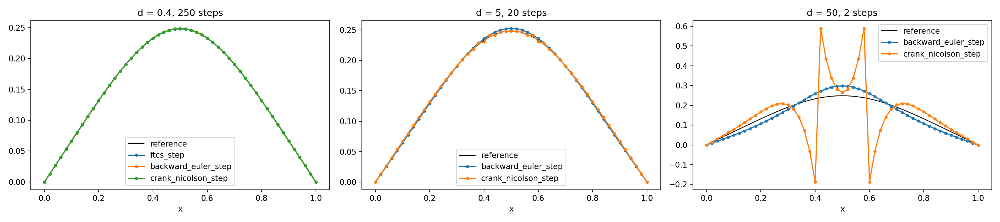

# CFD Fundamentals: 1D Finite-Difference Solvers

Explicit and implicit finite-difference solvers for the 1D linear advection and heat equations, written from scratch in Python/NumPy. Each solver is verified against exact or reference solutions, and its stability limits are tested by experiment rather than only derived on paper.



*Heat equation with a top-hat initial condition at t = 0.04. Backward Euler and Crank–Nicolson are compared with a fine-Δt reference at d = 0.4, 5 and 50 (FTCS is unstable above d = 0.5). At d = 50 both implicit schemes stay bounded, but Crank–Nicolson oscillates and goes negative while backward Euler stays smooth. Stable is not the same as accurate.*

---

## What's in here

| Equation | Schemes | Topics studied |
|---|---|---|
| Linear advection `u_t + c u_x = 0` (periodic) | First-order upwind, central (FTCS), Lax–Wendroff | CFL limit, numerical diffusion vs dispersion, measured numerical viscosity |
| Heat equation `u_t = α u_xx` (Dirichlet) | Explicit FTCS, backward Euler, Crank–Nicolson | Stability limit d ≤ 0.5, implicit unconditional stability, accuracy vs time step |

The implicit schemes solve a tridiagonal system at every step with a hand-written **Thomas algorithm** (O(n)), verified against `numpy.linalg.solve`.

---

## Key results

**Advection**
- Upwind is exact at C = 1. Its numerical diffusion D = (cΔx/2)(1 − C) was measured from the variance growth of a Gaussian and matches the analytical value.
- Lax–Wendroff is second order but dispersive: the square wave develops over/undershoots (min < 0, max > 1). Upwind stays monotone.
- Central differencing (FTCS) is unconditionally unstable for advection.
- Upwind past the CFL limit (C = 1.05) blows up as a grid-scale sawtooth that stays at the square-wave edges and is carried along with them.

**Diffusion**
- FTCS matches the exact solution `e^(−π²t) sin(πx)` to a max error of 1.7 × 10⁻⁴ (N = 51, d = 0.4, t = 0.1). That figure is the scheme's truncation error.
- Stability limit confirmed by experiment: at d = 0.49 the solution decays smoothly. At d = 0.51 a 2Δx sawtooth grows by a factor of ≈1.04 per step and reaches ~5 × 10⁶ after 500 steps.
- Implicit schemes at t = 0.04, compared with a fine-Δt reference:

| d | Steps | Backward Euler error | Crank–Nicolson error | CN min(u) |
|---|---|---|---|---|
| 0.4 | 250 | 3.9 × 10⁻⁴ | 7.7 × 10⁻⁵ | 0.000 |
| 5 | 20 | 4.1 × 10⁻³ | 2.3 × 10⁻³ | 0.000 |
| 50 | 2 | 5.0 × 10⁻² | 4.2 × 10⁻¹ | −0.188 |

  CN is more accurate at moderate d. At large d its grid-scale amplification factor approaches −1, so sharp data oscillates instead of being damped. Backward Euler's factor approaches 0 (L-stable).

---

## Repository layout

```
cfd-fundamentals/
├── src/                     # reusable solver code
│   ├── advection_1d.py      # upwind, central, Lax–Wendroff; test profiles; exact solution
│   ├── diffusion_1d.py      # FTCS, backward Euler, Crank–Nicolson steps; solve()
│   └── linalg.py            # Thomas algorithm (tridiagonal solver)
├── scripts/                 # one script per experiment, each writes a figure to results/
├── tests/
│   └── test_thomas.py       # Thomas vs numpy.linalg.solve
├── results/                 # figures
└── requirements.txt
```

---

## Setup

```bash
git clone https://github.com/suddu1201/cfd-fundamentals.git
cd cfd-fundamentals
python3 -m venv venv
source venv/bin/activate
pip install -r requirements.txt
```

## Running

Run everything from the repository root as a module, so the `src` imports resolve:

```bash
python -m scripts.implicit_stability
python -m tests.test_thomas
```

| Script | What it shows | Output |
|---|---|---|
| `upwind_first_look` | First-order upwind on a square wave and a Gaussian vs the exact solution | `results/advection_square.png`, `results/advection_gaussian.png` |
| `scheme_comparison` | Upwind vs central vs Lax–Wendroff on a square wave and a Gaussian | `results/scheme_comparison.png` |
| `central_blowup` | Growth of max\|u\| for central/FTCS advection | `results/central_blowup.png` |
| `viscosity_check` | Measured vs analytical upwind numerical viscosity | `results/viscosity_check.png` |
| `cfl_sweep` | Upwind at C = 0.95 (stable) vs C = 1.05 (unstable) | `results/cfl_sweep.png` |
| `heat_ftcs_stability` | FTCS vs exact solution; d = 0.49 vs 0.51 | `results/heat_runA.png`, `results/heat_runB.png` |
| `implicit_stability` | FTCS / backward Euler / Crank–Nicolson accuracy and stability up to d = 50 | `results/implicit_runB.png` |

---

## Next

- Observed order of accuracy: grid-refinement study and log–log error plots for every scheme
- Advection–diffusion and the cell Péclet number
- Verification toolkit: method of manufactured solutions, Richardson extrapolation
